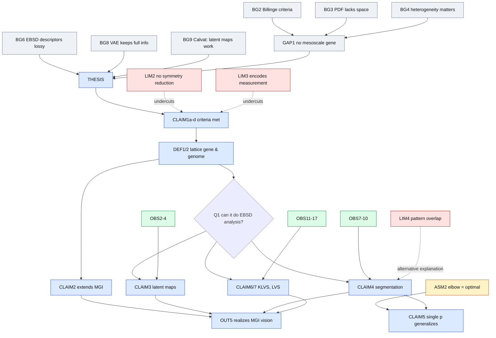

# Argument chain: Wang et al. 2026, "Lattice genome: representation and analysis of heterogeneous crystalline microstructures" (arXiv 2606.09611v1)

Human-readable logical flow with the evidence the paper gives for each step. Draft, 2026-10-21.

## How to read this

Each step is one **self-contained statement**, written so it still makes sense outside this paper, which is what lets chains from different papers be combined later. Every step has:

- **ID** and **type**:
  - `BG`: background fact taken from the literature
  - `GAP`: problem or gap
  - `DEF`: definition or new term
  - `ASM`: assumption
  - `METH`: method choice
  - `OBS`: observation from this paper's data
  - `CLAIM`: conclusion drawn by the authors
  - `LIM`: limitation the authors admit
  - `OUT`: outlook or speculation
- **Because**: the IDs this step relies on.
- **Evidence**: what the paper actually offers, with location. The tag shows the kind of evidence:
  - [cite]: a reference
  - [argument]: reasoning only
  - [data-qual]: a figure judged by eye
  - [data-quant]: numbers
  - [none]: nothing
- **Scope**: the materials and conditions it was shown for, where relevant.
- ⚠ marks where the evidence is weaker than the wording, or where a later step undercuts it.

---

## Part 1: Motivation (Introduction)

**BG1**: The Materials Genome Initiative assumes materials have an underlying "code" that dictates their behavior, but it is unclear what a materials gene looks like in practice.
Evidence: [cite] [1, 2]; Sec. 1 ¶1.

**BG2**: A generalized materials gene should be a vector that is compact, unique, experimentally accessible, and has a distance metric that reflects structural similarity.
Evidence: [cite] Billinge [3]; Sec. 1 ¶1.

**BG3**: Atomic pair distribution functions (PDFs) satisfy these criteria for uniform materials but carry no spatial (mesoscale) information.
Evidence: [cite] [3]; Sec. 1 ¶2.

**BG4**: In structural alloys, spatial heterogeneity in phases, orientations and defects controls macroscale properties.
Evidence: [cite] [4, 5]; Sec. 1 ¶3.

**GAP1**: Nobody has defined materials genes for spatially heterogeneous materials at the mesoscale.
Because: BG2, BG3, BG4. Evidence: [argument] Sec. 1 ¶3 (no literature survey).

**BG5**: EBSD maps Kikuchi diffraction patterns over large areas at the mesoscale, quickly and automatically.
Evidence: [cite] [6, 7]; Sec. 1 ¶4.

**BG6**: Conventional EBSD reduces each Kikuchi pattern to separate lossy descriptors (phase, orientation, lattice rotation and strain, GND and total dislocation density). Even combining them does not recover all the information in the pattern.
Evidence: [cite] [8–15]; Sec. 1 ¶4.

**BG7**: Earlier data-driven compressions (PCA, matrix factorization) and deep-learning methods either compress or extract known features. They do not give a holistic, compact encoding of the whole pattern.
Evidence: [cite] [16–25]; Sec. 1 ¶5.

**BG8**: A VAE trained on Kikuchi patterns compresses each one into a latent vector from which the pattern can be reconstructed to a set accuracy, so the vector keeps the full pattern information.
Evidence: [cite] [26–28, 15]; Sec. 1 ¶6.

**BG9**: Spatial maps of VAE latent features reveal heterogeneities such as dislocation cells and lattice-rotation domains, with higher sensitivity than conventional EBSD.
Evidence: [cite] Calvat et al. [15]; Sec. 1 ¶6.
Scope: AM and wrought Ni alloys (the same data source as this paper).

**THESIS**: VAE latent vectors of Kikuchi patterns satisfy Billinge's gene criteria, which extends the materials-genome concept to heterogeneous crystalline materials. These latent vectors also support standard microstructure analysis.
Because: GAP1, BG5–BG9. Sec. 1 last ¶.

---

## Part 2: The lattice gene concept (Sec. 2)

**CLAIM1a (compactness)**: A latent vector is a compact, low-dimensional representation of a Kikuchi pattern.
Because: BG8. Evidence: [argument] Sec. 2.
⚠ Not quantified. The paper never states the pattern size against the latent size (128, later 127).

**CLAIM1b (accessibility)**: With a pretrained encoder, anyone can get the lattice gene from a measured pattern in one forward pass.
Because: BG8. Evidence: [argument] Sec. 2.

**CLAIM1c (distance metric)**: Euclidean distance or angle between latent vectors reflects physical similarity of the lattice (crystallography, orientation, defects). The latent space is continuous, so it avoids the jumps in space-group classification.
Because: BG2, BG8. Evidence: [argument] Sec. 2.
⚠ Never tested directly, for example as latent distance against misorientation. Undercut by LIM2 and LIM3.

**CLAIM1d (informativeness and near-uniqueness)**: The patterns can be reconstructed from the latent vector, and Kikuchi patterns contain the lattice parameter, orientation, strain and defect density. So the latent vector encodes all of these, and maps near-uniquely to the local lattice state within the reconstruction error.
Because: BG6, BG8, BG9. Evidence: [argument] + [cite] [15]; Sec. 2.
⚠ Reconstruction shows that the code determines the *pattern*, not that the pattern uniquely determines the *lattice state*. The reconstruction error is not reported in this paper.

**DEF1 (lattice gene)**: the latent encoding of a single Kikuchi pattern, z_i ∈ ℝ^d.
Because: CLAIM1a–d.

**DEF2 (lattice genome)**: the spatially resolved collection of lattice genes over a statistically representative area or volume, Z ∈ ℝ^(H×W×d).
Because: DEF1, BG4.
⚠ The paper never checks whether the maps are statistically representative.

**CLAIM2**: The lattice genome extends the materials genome to mesoscale heterogeneous crystalline materials.
Because: DEF1, DEF2, GAP1. Evidence: [argument] by analogy with biology; Sec. 2.

**Q1 (bridging question)**: Can the lattice genome support the analyses done in conventional EBSD workflows?
This sets up the three tools in Parts 3 and 4.

---

## Part 3: Methods (Sec. 3, Supplement)

**METH1 (encoding)**: Each pattern goes through the pretrained encoder from [15]. One of the 128 dimensions is dropped because it mostly tracks measurement geometry, giving d = 127.
Evidence: Sec. 3; Sec. 4 ¶1 [observation, data not shown].

**METH2 (latent component maps)**: PCA of all lattice genes in a map, with the first 3 principal components shown as RGB. An optional pre-PCA step rescales each dimension so its 1st and 99th percentiles map to 0 and 1.
Evidence: Sec. 3; Sec. 4.1.

**METH3 (segmentation)**: Neighboring pixels go into the same domain when both the latent angle A (Eq. 1a) and the distance D (Eq. 1b) are below their thresholds A* and D*. Pixels are scanned row by row, comparing each with its right and lower neighbors. Domains with fewer than 6 pixels are dropped.
Evidence: Sec. 3; Sec. 4.2.
⚠ The paper doesn't say how conflicting labels are merged.

**ASM1**: Absolute thresholds don't transfer between microstructures, so A* and D* are set as the p-th percentile of each map's own distributions of A and D.
Evidence: [data-qual] Fig. S1/8 (the distributions differ between maps).

**ASM2**: The elbow of the curve of within-cluster sum of squares (WCSS) against number of clusters K marks the optimal segmentation.
Evidence: [argument] "We expect…", Sec. 3.
⚠ This is a heuristic assumption and is not validated.

**METH4 (threshold search)**: p is scanned from 95 down to 60 in steps of 1. The search stops when three consecutive WCSS reductions fall below 10 % of the mean of the first 8 steps, and p* is taken as the middle of that window.
Because: ASM1, ASM2. Evidence: Supplement. The 60–95 range comes from "preliminary tests" [none shown].

**METH5 (KLVS)**: kernel latent vector spread, the mean latent angle between a pixel and its nearest neighbors (Eq. 3). It is the analog of KAM.

**METH6 (LVS)**: latent vector spread, the mean latent angle between each pixel and its domain centroid (Eq. 4). It is the analog of GOS and is computed per *domain*.

**DATA**: Three EBSD maps, all taken from Calvat et al. [33]:
- RX: wrought IN718, fully recrystallized
- W: Waspaloy, partially recrystallized
- AM: IN718 built by directed energy deposition

Scope note: all are FCC Ni-base alloys and use one encoder. The paper doesn't say whether that encoder was trained on these maps.

---

## Part 4: Results (Sec. 4)

### 4.1 Visualization

**OBS1**: The first 3 PCs explain 25–37 % of the variance, and about 20 PCs are needed for nearly 100 %.
Evidence: [data-quant] Fig. 2c.

**OBS2**: Latent component maps show the same grain-scale heterogeneity as IPF maps in all three states.
Evidence: [data-qual] Fig. 2a vs. 2b.

**OBS3**: Latent component maps show features that are faint or missing in IPF maps:
- polishing deformation and an extra grain in RX
- smooth gradients in W ("likely orientation variations")
- substructure in AM ("likely dislocation cells")

Evidence: [data-qual] Fig. 2d, insets A–D.
⚠ The physical interpretation is hedged ("likely") and has no independent check.

**OBS4**: Pre-PCA scaling shows an annealing twin and intragranular gradients that unscaled maps miss and that otherwise appear only in maps of single dimensions.
Evidence: [data-qual] Fig. 3.

**OBS5**: In a 2D PCA projection, the lattice genes form visible clusters, most clearly in RX.
Evidence: [data-qual] Fig. 4.

**CLAIM3**: Latent component maps are a useful analog of orientation maps and reveal finer heterogeneity.
Because: OBS2–OBS4. Answers Q1 for visualization.

**CLAIM3b**: Clustering in latent space is a feasible route to segmentation.
Because: OBS5.

### 4.2 Segmentation

**OBS6**: The optimal percentiles are p76 for RX, p80 for W and p73 for AM.
Evidence: [data-quant] Sec. 4.2; Fig. S2/9.

**OBS7**: Domain boundaries largely coincide with grain boundaries from 5° misorientation thresholding, most closely for RX and W.
Evidence: [data-qual] Fig. 5a. No overlap metric is given.

**OBS8**: The latent method finds more domains than conventional grains:

| State | Grains | Domains |
|---|---|---|
| RX | 624 | 1269 |
| W | 3314 | 3634 |
| AM | 1326 | 3143 |

Evidence: [data-quant] Fig. 5a.

**OBS9**: Some grain boundaries are missed: small grains in AM and W, regions with poor indexing in RX, and "a few regular grain boundaries".
Evidence: [data-qual] Fig. 5a.

**OBS10**: Grain and domain area distributions match closely for RX and W but not for AM.
Evidence: [data-qual] Fig. 5b. No statistical test is given.

**CLAIM4**: Segmentation in latent space yields domain maps consistent with grain maps and is more sensitive.
Because: OBS7, OBS8, OBS10.
⚠ Extra domains are read as sensitivity, but nothing independent shows they are real boundaries. OBS9 is not weighed against this claim.

**CLAIM5**: A single percentile parameter with automatic elbow detection works across very different microstructures without calibration for each case.
Because: ASM1, ASM2, METH4, OBS6. Evidence: n = 3; Sec. 5 ¶5.
⚠ The Supplement extends this to "readily generalize to any EBSD dataset".

### 4.3 Heterogeneity quantification

**OBS11**: KLVS and KAM show the same qualitative trends: high values at boundaries in RX, high values throughout W, and patches in AM.
Evidence: [data-qual] Fig. 6.

**OBS12**: High-KAM artifacts from poorly indexed grains (RX) and a polishing scratch (W) are absent or weaker in KLVS.
Evidence: [data-qual] Fig. 6.

**OBS13**: KLVS resolves substructure inside large AM grains that KAM does not show.
Evidence: [data-qual] Fig. 6b. The paper links this to [15].

**OBS14**: KLVS spans 0–120° and KAM 0–8°, so the absolute values can't be compared.
Evidence: [data-quant] Fig. 6 color bars.

**OBS15**: The distance-based variant (D-KLVS) gives maps similar to the angle-based KLVS.
Evidence: [data-qual] Fig. S3/10.

**OBS16**: LVS maps show the same trends as GOS: low in RX, high in W, intermediate in AM.
Evidence: [data-qual] Fig. 7a,b.

**OBS17**: The LVS and GOS distributions differ, most of all for AM, and for RX and W the peaks look alike but are shifted.
Evidence: [data-qual] Fig. 7c.

**CLAIM6**: KLVS reproduces KAM trends with better contrast and fewer artifacts, because it works on the encoded pattern instead of indexed orientations.
Because: OBS11–OBS13. Evidence: [argument] for the mechanism; [data-qual] for the effect.
⚠ No contrast metric is given. The mechanism sits uneasily with LIM3, since the gene also encodes noise.

**CLAIM7**: LVS is a high-dimensional analog of GOS.
Because: OBS16, OBS17.
⚠ The comparison mixes up the metric (LVS vs. GOS) and the segmentation (domains vs. grains).

**CLAIM8**: Angle and distance in latent space are both consistent descriptors of local variation.
Because: OBS15.

---

## Part 5: Limitations the authors state (Sec. 5)

**LIM1**: Latent component maps depend on the dataset, because PCA is fitted per map, so colors don't carry over between maps the way IPF colors do.
Qualifies CLAIM3.

**LIM2**: Crystal symmetry is encoded only implicitly. Latent angles aren't reduced by symmetry, so KLVS and LVS are systematically larger than KAM and GOS and don't match them quantitatively.
Evidence: [argument] explaining OBS14 and OBS17.
⚠ It also undercuts CLAIM1c, because symmetry-equivalent states need not be close in latent space. The paper doesn't make this link.

**LIM3**: Lattice genes also encode measurement conditions: detector geometry, pattern center, background and noise. This makes comparisons across datasets harder.
Evidence: [cite] [36] + [argument]; consistent with METH1.
⚠ Undercuts CLAIM1c and CLAIM1d. The paper doesn't make this link.

**LIM4**: At grain or twin boundaries the pattern is a superposition of several lattices, so the gene encodes a mixture. This makes it harder to interpret but more sensitive, and it partly explains the extra domain boundaries.
Evidence: [cite] [37–39, 15].
Partly explains OBS8. This is an alternative explanation to "finer real microstructure".

## Part 6: Advantages and outlook (Sec. 5, 6)

**CLAIM9**: The framework needs no indexing (Hough or dictionary), so it should apply to patterns that are hard to index, such as heavily deformed or multiphase regions.
Evidence: [argument] + [cite] [10].
⚠ Not demonstrated here, since all three maps are single-phase and indexable.

**CLAIM10**: One encoded dataset can be reused for many downstream tasks without reprocessing.
Evidence: [argument].

**OUT1**: Physically constrained encoders (rotation-invariant, conditional, disentangled) could fix LIM1–LIM3.
Evidence: [cite] [40–42].

**OUT2**: Training on large, diverse data should give a universal, instrument-invariant encoding.
Evidence: [none]. The paper says "we expect".

**OUT3**: The tools are encoder-agnostic and "will remain applicable" as encoders change.
Evidence: [argument]. The tools only need vectors.

**OUT4**: The framework can extend to chord-length distributions, GAM, GROD, n-point statistics, multiphase materials, EDS coupling and ML property prediction.
Evidence: [cite] [43–49]. Nothing is demonstrated.

**OUT5**: The lattice genome "may offer a practical realization of the MGI vision" at the mesoscale.
Because: CLAIM2, CLAIM9, CLAIM10, OUT4.

---

## Part 7: The Conclusion's claims and what they rest on

| Conclusion statement | Rests on | Weakest link |
|---|---|---|
| Lattice gene satisfies Billinge's criteria | CLAIM1a–d | [argument] only; LIM2 and LIM3 cut against CLAIM1c |
| The genome extends the MGI to the mesoscale | CLAIM2 | analogy |
| Latent component maps reveal subtler variations | CLAIM3 | [data-qual], interpretation hedged as "likely" |
| Segmentation agrees with grain maps | CLAIM4 | no overlap metric; extra domains not independently checked |
| LVS and KLVS recover trends "while offering better contrast" | CLAIM6, CLAIM7 | contrast shown only by eye, and only for KLVS |
| Works without indexing | CLAIM9 | not tested on hard-to-index data |
| Will stay applicable as encoders evolve | OUT3 | forward-looking |

## Argument map

## Notes toward the formal format

Things this paper showed the format needs, beyond "claim + evidence":

1. **Statement types**: BG / DEF / ASM / METH / OBS / CLAIM / LIM / OUT.
2. **Evidence kind and location**: cite, argument, qualitative data or quantitative data, plus the figure or equation. This is what lets you judge how strong a step is.
3. **Relations other than "supports"**: undercuts, alternative explanation, qualifies, analog-of (KLVS ↔ KAM).
4. **Scope on every OBS and CLAIM**: material system, processing state, technique and instrument, sample size. This is essential for combining chains across papers, because a claim may only hold for FCC Ni alloys.
5. **Shared vocabulary for entities** (EBSD, KAM, GOS, IN718, Kikuchi pattern) so that statements from different papers can link. An existing materials ontology could provide it, such as EMMO or the MatOnto/NFDI-MatWerk ontologies.
6. **External links**: a BG step in this paper (for example BG9 ← Calvat et al.) should point at the matching CLAIM node in that paper's own chain. That is the hook for merging chains.
